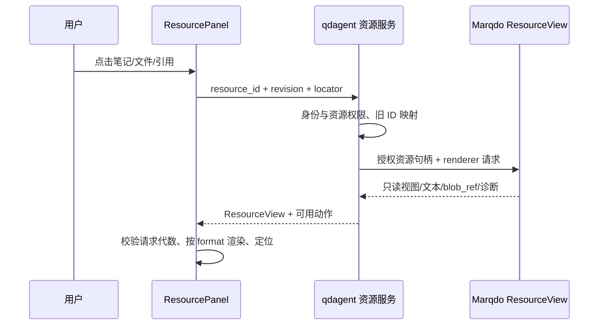

# 求道智能体能力与侧栏预览：详细产品及开发设计

| 项目 | 约定 |
|---|---|
| 状态 | **Proposed / 待实现**；本次是调研和设计交付，不表示用户反馈已修复 |
| 日期 / 代码基线 | 2026-10-27（Asia/Shanghai）；qdagent `68b757e02ebfb64833b5262b0c8a683512581e8b`，Marqdo `16f26d7d60ce9fbc62feb0e8e83f93951f7b53fe` / 2.1.4 |
| 调研 | [智能体能力官方调研与源码复核](../../../marqdo/doc/research/agent-capabilities-2026-10-27.md)（同级仓库） |
| 框架配套 | [Marqdo 恢复、工具、上下文与资源协议](../../../marqdo/doc/design/agent-reliability-tools-resources-2026-10-27.md) |
| 继承 | [qdagent 2.0](qdagent-2.0.md)、[10-25 工作台设计](multi-provider-and-knowledge-workbench-2026-10-25.md)、[10-26 可靠工作台](reliable-workbench-development-2026-10-26.md) |
| 已有交付参考 | [Q-R0–R9 实施说明](../releases/reliable-workbench-q-r0-r9-2026-10-26.md)、[真实路由清单](route-inventory-2026-10-26.md) |

## 1. 产品目标

求道应能找到资料、读取文件、形成判断、执行授权操作、验证结果，并把有价值的工作沉淀为可复用知识。聊天先给出用户需要的结论；完整笔记、代码和报告留在可预览、可追溯的产物中。错误不应导致用户丢失进度，预览不应打断正在进行的对话。

本轮优先完成用户明确指出的五个问题：错误恢复、回答过长、侧栏按钮跳转、工具覆盖不足、笔记和工作文件缺少渲染。后续再扩展长任务、连接器、计划、记忆和受控委派。

继续遵守：Marqdo 是唯一 Agent Runtime/EKC；qdagent 提供会话、产品策略、授权、资源映射和界面。不得在前端、gateway 或新的 Python 服务里创建第二套 LLM/tool loop。`doc/next/*` 保留原文。

## 2. 本次发现与处理决策

| 用户问题 | 最新源码事实 | 本次决策 |
|---|---|---|
| 错误恢复不好 | `ask` 有一次门禁修复，但成功后仍可能返回旧 `raw`；失败 mode 与 ok/status 可能矛盾 | accepted candidate 单一提交；保留草稿、分级错误、有界重试、按失败类型提供恢复操作 |
| 答案有时很长 | `契约提示` 对 ASK 也强制任务/结论/main/验证/元数据等六段文档；完整历史继续注入 standing | 聊天表达与知识产物分开；普通 ASK 简洁回答；知识文档保留完整结构和门禁 |
| 右侧按钮在跳转 | `RightNotesPanel` 仅 navigate('/notes')；文件面已 openTarget，不是全部都跳转 | 资源默认点击就在右栏预览，“在主区打开”是独立次要动作 |
| 工具少 | `eng_tools` 默认五个工程工具；框架已有更多原语，但未形成求道常用工作能力 | 建立按场景发现的业务工具目录，优先覆盖资料、文件、笔记与验证闭环 |
| 笔记/工作文件不渲染 | Notes detail 是 pre-wrap 文本；Reader 主要接 DocumentView；profile_item 未读取；常见二进制格式没有统一分派 | 所有入口共用 ResourcePreview，按 MIME/能力分派并保留明确降级 |

额外问题：Reader 与旧 rightbar 互斥且分别管理状态；RightFilesPanel 默认第一个 workspace 且只显示根目录前 40 个文件；resumeTurn 对服务端终态直接返回，可能未补齐本地最终消息。上述为静态审计结论，需要真实 UI/HTTP 故障注入验收，不宣称已现场复现。

## 3. 主流能力对照与取舍

| 参考机制 | 求道采用方式 | 交付次序 |
|---|---|---|
| [OpenAI：MCP 与 tracing](https://developers.openai.com/api/docs/guides/agents/integrations-observability) | 工具调用、修复、产物统一关联到 turn，默认过程折叠 | P0 起 |
| [OpenAI：压缩与记忆](https://developers.openai.com/cookbook/examples/agents_sdk/building_reliable_agents_memory_compaction) | 当前任务摘要、长期偏好、完整知识产物各有生命周期 | P1 |
| [LangGraph：检查点与持久化](https://docs.langchain.com/oss/python/langgraph/persistence) | 接入 Marqdo 恢复句柄，避免前端重新发送整轮 | P0→P1 |
| [Claude：按需工具发现](https://platform.claude.com/docs/en/agents-and-tools/tool-use/tool-search-tool) | 默认少量核心工具，按任务加载其他工具 schema | P1 |
| [Gemini：文件检索](https://ai.google.dev/gemini-api/docs/file-search) | 搜索结果带源版本和定位，能从答案直接预览 | P1 |
| [MCP Resources](https://modelcontextprotocol.io/specification/2025-06-18/server/resources) | 资源作为可读对象；预览不自动注入上下文 | P0→P1 |
| [Claude Artifacts](https://support.claude.com/en/articles/17153992-what-are-artifacts-and-how-do-i-use-them) | 完整产物在对话旁呈现，正文与聊天各自保存 | P0 |
| [Deep Agents](https://docs.langchain.com/oss/python/deepagents/overview) | 复杂任务可选规划和后续委派，普通问题保持简单 | P1→P2 |

这里是设计推导，不是竞品全量测评。暂缓默认多智能体、全自动浏览器操作和全部 Office 保真编辑，先保证单智能体任务闭环。对外界面只显示部署实际可用的能力。

## 4. 用户场景与可观察行为

### 4.1 普通问答

用户问“这段配置有什么问题”：先给问题与改法，必要时附引用。无需先显示任务复述、main、验证和元数据。不为闲聊生成虚构可执行代码。若需要检索或工具，简短显示真实阶段；内部调试信息放运行详情。

### 4.2 生成长文档

用户要求“写详细设计文档”：生成完整资源，聊天给结论、主要结构、完成状态和可点击产物卡；点击在右栏打开完整正文。用户明确要求直接在对话展示全文时尊重请求。不能为满足短回答指标裁掉用户要求的内容。

### 4.3 修复失败

首次工具调用超时：显示“读取暂时失败，正在重试”，在框架允许的预算内重试。文档校验失败：保留草稿与诊断，局部修复后重新验证；成功只展示修复后的版本。失败耗尽：说明完成了什么、卡在哪里，并给“查看草稿 / 重试失败步骤”等可执行动作。

### 4.4 边聊天边预览

用户在模型输出期间点击右栏笔记、文件或引用：主路由、会话 ID、输入草稿、聊天滚动位置保持不变，右栏显示内容。返回列表、切换资源、关闭预览不取消模型任务。切换资源 A→B 后，A 的迟到请求不得覆盖 B。

### 4.5 文件分析与变更

用户说“读这个 CSV，计算各月趋势，整理成笔记”：选择文件并加入当前消息→读取范围/检索→在沙箱计算→生成表/图/笔记→验证→摘要与资源卡。用户说“修改配置”才进入写工具，先读取 revision，提交补丁，展示变更；并发编辑冲突保留双方版本，不覆盖。

## 5. 回答策略与知识产物

### 5.1 保留 ASK / BUILD / LEARN，增加表达策略

`response_kind` 是表达字段，不是第四种运行模式：`direct_answer | answer_with_artifact | artifact_requested`。ASK 可以直接回答或生成知识笔记；BUILD 保留 preflight→reuse/adapt/create→verify；LEARN 保留确认和知识编译规则。

这是对当前“每次 ASK 的聊天返回必须是完整可执行文档”的**拟议产品规则调整**，不是偷偷删除文档门禁。它保留文档原生知识真相，将门禁作用域收敛到实际生成的知识/执行产物。实施时同步更新 `agent/qdagent.mq.md`、`execution/docgate.mq.md`、[文档合同设计](09-document-contract-and-docgate.md) 和对应 fixtures；明确该提案被采纳后才改变行为，不能仅在前端隐藏错误产物。

过渡切片可先保留现有文档生成，把已通过门禁的结论投影为聊天摘要，不改变产物格式；随后启用 direct_answer，减少普通问答不必要的生成与验证成本。

| detail | 适用 | 中文正文软目标 | 产物规则 |
|---|---|---|---|
| concise | 默认普通问答、状态与操作结果 | 80–250 字；简单事实可更短 | 长细节折叠或放产物 |
| standard | 解释、比较、带少量步骤的任务 | 250–700 字 | 多章节内容优先产物 |
| detailed | 用户明确要求深入说明 | 按任务完整性决定，不强制上述字数 | 长报告默认产物；允许明确要求的对话全文 |

以上是拟定软目标，不是机械截断器；表格、代码、引用与资源卡单独统计。优先级：当前用户明确要求 > 当前回合选择 > 会话偏好 > 用户偏好 > 默认。模型 token 上限与中文字符目标分开管理，达到预算显示 partial/continue，不截断句子、代码或 JSON。

默认结构：一句核心结论→必要证据或步骤→产物/引用。完成型任务说明做了什么、验证到什么程度和残留问题。无实测不能说已通过；未授权执行不能说已执行。

### 5.2 AnswerEnvelope 与 accepted candidate

产品结果映射框架 AgentOutputV1，应用额外持有 `message_id/turn_id/response_policy/workspace_id`。

```json
{
  "schema_version": 2,
  "ok": true,
  "request_id": "req_01",
  "data": {
    "turn_id": "turn_01",
    "outcome": "succeeded",
    "answer": {"message_id": "msg_01", "format": "markdown", "text": "已整理，完整笔记见右侧。"},
    "artifacts": [{"resource_id": "res_01", "revision": "rev_02", "title": "分析笔记"}],
    "citations": [],
    "accepted_candidate_id": "candidate_02",
    "verification_ref": "verify_02"
  }
}
```

提交顺序：候选原文→实际校验→必要修复→校验通过的 accepted candidate→持久产物 revision→可重建 answer projection→提交终态事件。修复后必须用 `r2`/accepted 内容替换 `raw`；正文、验证 digest 和 artifact 指向同一版本。失败时返回明确 outcome，不能 `gated_error + status=ok`。

应用 envelope 的 `ok` 表示本次 API 操作是否成功；任务执行成功由 `outcome` 表达。创建任务可 `ok=true/state=accepted`，查询失败任务也可 `ok=true/outcome=failed`；同步执行返回失败则 `ok=false`。兼容旧 `/v1` 出口需集中映射，不能将失败对象拼成普通 assistant 成功文本。

direct_answer 没有文档验证时标 `not_applicable`；artifact_requested 未通过门禁可以展示“草稿”，不能进入已发布知识或默认复用索引。回答摘要可确定性提取结论；需要模型压缩时限制为一次独立 purpose=summary 调用，不能重新执行工具。

### 5.3 流式与消息展示

只把 `answer` channel 的 delta 加入聊天正文；`artifact` delta 更新预览中的草稿资源；`progress` 显示实际阶段；`diagnostic` 在展开详情中显示。现有消息缺 channel 时由协议版本适配，不能把工作簿全文 token 先灌进聊天再删除。

聊天 Markdown 与资源 Markdown 共用安全渲染组件和样式；代码块可复制，表格横向滚动，引用可定位。长回答提供“展开全文/收起”只是阅读便利，不代替上游长度控制。默认最多显示 3 条近期过程摘要，完整动作时间线可展开；不展示模型内部推理。

## 6. 错误恢复体验与会话一致性

### 6.1 由服务端给出恢复动作

```text
recoverable transport → 自动有限重试 → 成功 / exhausted
invalid arguments     → 参数修复 → 再调用 / exhausted
validation failed     → 草稿保留 → 局部修复 → 重验 / needs_input
unknown effect        → 对账 → 续跑 / needs_input
auth / permission     → needs_input
cancelled             → 停止；只有显式继续才创建新 attempt
```

qdagent 不自行决定工具重试；接收 Marqdo error/recovery_options，将其映射为中文动作。所有自动操作受已授权范围限制，普通读取无需多次确认；外部发送、删除或超出任务范围的操作按产品权限政策处理。

| code / state | 用户说明示例 | 操作 |
|---|---|---|
| provider.rate_limited | 服务繁忙，稍后重试此步骤 | 自动倒计时；耗尽后手动重试 |
| provider.auth_failed | 当前模型凭证不可用 | 打开对应提供商设置；保留输入和草稿 |
| tool.invalid_arguments | 工具参数未通过校验 | 有界自动修复；详情显示字段而非大段堆栈 |
| document.validation_failed | 草稿已保存，验证未通过 | 查看草稿、查看问题、修复并重验 |
| resource.not_found | 原文件已删除或不可访问 | 选择其他资源；不改为猜测回答 |
| reference.version_unavailable | 此引用对应的历史版本不可用 | 主动查看最新版；明确版本变化 |
| revision.conflict | 文件已有新修改 | 预览差异，基于新版重新生成补丁 |
| interrupted | 运行被中断，已保留完成步骤 | 服务端许可时继续；否则查看恢复说明 |
| unknown_effect | 上一步结果尚未确认 | 查询状态/人工确认；不提供盲目“全部重试” |
| budget_exhausted | 已完成部分工作，预算已用完 | 查看部分结果；显式继续并给新预算 |

错误区不把原始失效文本当答案，不清空用户输入，不覆盖已经完成的有效结果。恢复动作请求必须带 expected revision，双击或浏览器重试只产生一个 attempt。

### 6.2 断网、刷新与终态补齐

`resumeTurn` 先查询快照，消费 `state/result_ref/last_seq/answer_revision`。即使服务端 completed/failed/cancelled，也必须检查本地最终消息是否落后并补齐，不能只看到终态就 return。

运行中：按 cursor 重放后续事件，再订阅；缺失事件日志时服务端返回最新消息快照和新 cursor。序号单调且去重，跨 attempt 以 `(task_id,event_id)` 区分，不能把另一个运行的 delta 拼到当前消息。

断流只改变连接状态，不立即判定任务失败。刷新不重新 POST 用户任务。用户“继续执行”与网络“重新连接”两个按钮分别调用恢复和事件接口。原终态保持不可变，新任务关联原 turn 的逻辑工作与 `resumed_from`。

同会话默认一个活动 turn，其他消息明确排队；预览完全独立。切换模型只影响下一轮；跨 provider 恢复需要重新冻结配置并告知变化，不能静默改变正在执行任务的模型与数据边界。

## 7. 一个真正承载内容的右侧面板

### 7.1 布局与导航规则

```text
左导航             当前会话/主工作区                         右侧资源面板
会话列表           回答摘要 + 引用/产物卡                    笔记 | 文件 | 工作区
笔记入口           用户输入草稿保持                         搜索 / 当前工作区
工作区入口         模型持续输出                             列表 → 资源正文
                                                           返回 | 标题 | 版本 | … | 关闭
                                                           正文 / 源码 / 差异（按能力）
                                                           加入上下文 | 在主区打开
```

侧栏 tab 只改变本地面板视图；资源列表点击打开 preview；目录点击进入目录；引用点击打开对应版本/定位。浏览器主路由和会话不变。“在主区打开”明确导航到资源页面，“编辑”明确进入编辑面。左侧主导航仍保留正常导航含义。

右栏不再保留“查看全部笔记”作为唯一内容，改为分页笔记列表和内嵌正文；需要完整管理页时在菜单提供次要入口。工作区 tab 显示已授权工作区及当前上下文，选择后在面板内浏览树；不默认选全局第一个 workspace。改变本轮执行 workspace 必须是独立动作，不能因为预览别的工作区而悄悄改变 Agent 工作根。

### 7.2 统一状态模型

将 `DesktopFrame` 的 rightbarOpen/rightbarTab/rightbarWidth 和 `context-panel-store` 合并为单一面板状态，Reader 成为内部 renderer，不再与旧右栏互斥挂载。

```ts
type PreviewTarget = {
  kind: 'note' | 'file' | 'document' | 'citation' | 'artifact' | 'profile_item'
  workspaceId: string
  resourceId: string
  revision?: string
  locator?: { nodeId?: string; line?: number; page?: number; cell?: string }
}
type ResourcePanelState = {
  open: boolean
  tab: 'notes' | 'files' | 'workspace'
  mode: 'list' | 'preview'
  target: PreviewTarget | null
  requestGen: number
  width: number
  backStack: PreviewTarget[]
  forwardStack: PreviewTarget[]
  // 缓存和滚动以 workspace/resource/revision/locator 为 key；载荷单独管理
}
```

这是建议类型，不代表已有字段。profile_item 的 scope 由服务端解析，不把个人资源伪装成任意 workspace 文件。旧 `ReaderTarget` 转换为此类型的适配器应集中维护。

每次切换 target：取消旧 fetch→递增 generation→清理旧正文/错误/outline→加载元信息与视图→仅接受匹配 generation 响应。loading/error/outline 都要防迟到覆盖；关闭面板后迟到结果不重新打开。后退/前进恢复版本、目录、滚动和正文状态；失败记录仍可退回，不形成无限栈。

渲染完成后恢复滚动；引用定位优先于普通滚动缓存。panel state 按 session/workspace 记录有限最近历史；资源内容缓存仅在已授权客户端内，退出登录和权限变化清理。浏览器 Back 默认仍是主路由操作；面板内部使用自己的返回按钮。

### 7.3 尺寸、可访问性与空态

桌面建议默认宽 440px，可拖动约 360–720px，但要动态保证主区可用宽度；宽度取值是拟定 UI 基线。小屏使用抽屉/全屏预览并保留底层会话，关闭返回原输入位置，不能强塞三栏。按钮支持键盘、明确 aria-label，Esc 关闭并把焦点还给触发项；页面加载错误可用键盘重试。

必须区分 loading、empty、not_found、forbidden、unsupported、partial、stale 和 error。错误时显示资源名、原因、重试/下载等真实可行动作，不能统一显示“选择文档以阅读”。

## 8. 资源与渲染体系

### 8.1 资源统一，权限不混合

资源适配服务把旧 run note、笔记、workspace file、知识 document、引用和生成产物转换成框架 ResourceRef。资源 ID 是 opaque，不由标题或绝对路径拼接。服务端验证当前身份、资源 owner 与 workspace scope；缺 workspace 不再默认读项目 `.`。

旧 `/notes/:slug` 与 `api.getRun` 继续可用，通过适配得到 run note 的 ResourceRef；不批量迁移或改写用户内容。原 `content` 是源码权威，HTML、摘要、outline、搜索索引是可重建派生物。资源 title、URI 与 revision 分开，重命名不破坏已保存引用。

资源预览链：



### 8.2 共用 ResourcePreview，不在每个页面各写一套

| 类型 | P0/P1 视觉表现 | 可用动作 | 实现归属 |
|---|---|---|---|
| 求道笔记 / 普通 Markdown | 标题、段落、列表、引用、表格、代码、目录 | 预览/源码、复制、加入上下文 | 框架静态内容/转换；qdagent 共享 renderer |
| `.mq.md` | DocumentView 正文、语义节点、调用说明和引用 | 正文/源码、定位；执行为独立动作 | Marqdo 语义，qdagent UI |
| 代码 / txt / 日志 | 行号、高亮、范围读取、大文件分页 | 复制选段、定位行、下载 | 框架有界读取；qdagent CodePreview |
| JSON | 折叠树与源码切换，解析错误提示 | 复制路径/值、加入片段 | 框架解析上限；qdagent JsonPreview |
| CSV | 虚拟表格、列名、行数、分页 | 选行列、下载 | 框架有界解析；qdagent TablePreview |
| PNG/JPEG/WebP 等 | 图片和尺寸、缩放 | 下载、加入消息（模型支持时） | blob 服务；qdagent ImagePreview |
| PDF（P1） | PDF.js 页渲染、页码、缩放和页定位 | 下载、选择页；提取文本能力独立 | 框架资源/提取，qdagent PdfPreview |
| DOCX/XLSX/PPTX（P1 后段） | 转换后的 PDF/表格/HTML，标明可能格式差异 | 原件下载、查看转换结果 | Marqdo 转换插件；qdagent 进度与渲染 |
| HTML / SVG | 默认安全源码，受限预览按独立能力开放 | 下载、切换受限预览 | 两层清洗/隔离 |
| 未知二进制 | 文件名/类型/大小 + 不支持说明 | 下载 | qdagent fallback |

预览与提取分开：PDF 能看到页面，不代表 Agent 已能读文字；图片能预览，不代表模型支持 vision；Office 转换插件缺失时明确说明，不无限 spinner。上传可接受格式也不应仅由预览格式推断，需独立限制。

聊天、右栏、笔记详情、工作区和生成产物复用同一组件入口。`.mq.md` 不走普通 Markdown 解释器取代语义视图；通用 Markdown 不应触发全项目 EKC 编译。数学公式、Mermaid 可在 P1 加入，配置禁交互/外链等危险能力；失败降级为源码，不阻塞全文。

### 8.3 渲染安全与性能

替换 `sanitizeHtmlFragment` 的正则处理，使用成熟 DOM allowlist（候选 [DOMPurify](https://github.com/cure53/DOMPurify)），严格 format enum，未知格式按不支持处理。清洗前不得把不可信 DOM 插入页面；禁止事件、脚本、危险协议、任意嵌入、表单与样式注入。相对图片/链接由资源服务授权解析，避免任意 file:// 与外部跟踪请求。

只读预览不执行 Marqdo main、不运行代码块、不执行宏、不自动访问文档所写 URL。外链新窗口显式操作；interactive artifact 后续放独立 sandbox，不能把生成 HTML 直接塞入主应用权限上下文。PDF.js 的用途依据 [官方说明](https://mozilla.github.io/pdf.js/)，具体版本在实施时锁定并测试。

前端按 MIME/扩展名/服务端嗅探结果综合分派，以服务端允许的 renderer 为准。大文件分页、懒加载、转换任务可取消；缓存按资源 revision/renderer/policy 版本，权限检查先于返回。初始目标：100 KiB 以内 Markdown 暖缓存首屏 p95 < 1 秒，20 页 PDF 首屏按页渐进加载；需在约定网络和硬件下测试，不宣称已达到。

## 9. 工具能力产品化

### 9.1 基础目录

下列是**拟新增或改造的工具 ID**，不是当前已暴露接口。现有五个 `tool_*` 继续作为兼容别名。领域工具实现为 qdagent `.mq.md` 函数并注册给 Marqdo dispatcher；框架负责执行机制。

| 工具组 / ID | 输入→输出重点 | 权限与效应 | 阶段 |
|---|---|---|---|
| `tools.search / describe` | 意图/工具 ID→授权且可用 schema | 只读，不暴露无权连接器 | P1 |
| `workspace.list / search / read` | workspace、查询、resource、范围、revision→树/命中/片段 | 只读；搜索结果带定位与游标 | P0→P1 |
| `notes.search / read` | 查询/笔记 ID→正文片段、版本、来源 | 只读，区分个人/项目范围 | P1 |
| `notes.create / update` | 内容/补丁、expected revision→资源和 diff | 写入；保留历史，CAS | P1 |
| `files.patch` | resource、expected revision、补丁→diff/新版本 | 写入；原子提交，不允许任意绝对路径 | P1 |
| `knowledge.find / reuse / bind / verify` | 查询/任务/绑定参数→实际发现、执行和证据 | 延用现有 preflight/门禁；bind 可有执行效应 | P0 保留 |
| `web.search / fetch` | 查询/URL、时间/域限制→摘要、正文片段、来源 | 网络读取，限制域/大小/重定向/内网地址 | P1 |
| `code.run / tests.run` | 代码或测试入口、资源输入→stdout/artifacts/verification | 受限沙箱执行、超时/网络/文件 scope | P1 |
| `artifacts.create / update` | 内容、媒体类型、来源→持久资源引用 | 写入结果区，版本化 | P1 |
| `resources.read` | resource/revision/range→可给模型的内容 | 只读；与 UI preview 同源但投影不同 | P1 |
| `memory.list / propose / update / forget` | scope、来源、确认→长期偏好/删除结果 | 用户可控，不自动永久保存敏感推测 | P1 |
| `plan.update / task.status` | 里程碑/任务 ID→实际计划与状态 | 仅更新当前任务规划，不伪造执行结果 | P1 |
| `mcp.*` 按连接器命名空间 | 经 schema 验证的连接工具 | 安装授权范围、用户动作限制 | P1 后段 |
| `browser.* / delegate.*` | 受控浏览器/子任务 | 更小权限、共享总预算与效应记录 | P2 |

核心工具不能只会“找”不能“读”；搜索结果必须可 `read`，产物必须可 `preview`，修改必须可看 diff，执行必须有真实 receipt。工具存在但缺依赖/凭证时在工具面板显示“未配置/不可用”，模型只获得可执行集合或明确失败原因。

建议默认常驻 `tools.search/describe`、资源读取、工作区搜索与知识发现等少量工具；按场景加载笔记写入、网页或执行集合。工具检索命中不等于授权，不因工具名含 read 就认定无副作用。

### 9.2 参数、结果与治理

所有输入有 schema 与长度/范围限制，输出统一 `summary + structured_content + resources + citations + error`。长输出写入资源，模型按范围读取。调用记录公开工具名称、目的、状态、耗时和可预览结果；详细参数脱敏。

预览工具结果不是额外执行。工具不能通过任意 URL/路径读取超出 workspace 的资源。网页正文、笔记内指令和 MCP 返回的说明都是数据；不能改变产品系统政策。外部发送/删除等动作根据用户任务授权和效应范围处理，授权有效时不反复询问。

`lib/web_search.mq.md` 固定临时文件桥不直接投入新并发工具面：迁移到框架网络工具或独立每 call 的输出路径/句柄，捕获退出码、超时、来源 URL 和 fetched_at。搜索摘要只作为线索，回答关键事实需 fetch 原文；正文被截断/访问失败必须保留证据状态。

每条工具结果都带源版本/时间和 trust，不能将搜索 snippets 标为“已验证”。多源冲突保留差异，引用点可跳到右侧原文。对当前无法联网的部署，不伪造即时资料。

## 10. 上下文、记忆、计划与产物

### 10.1 预览与加入上下文分离

点击资源只预览，不调用模型、不自动上传全文。用户点“加入上下文”或明确要求分析资源时，在输入框显示 chip：名称、版本、选段/页码、可移除；发送时冻结 ResourceRef。资源更新后提示引用的是旧版，用户可选择刷新。

自动检索与用户显式 pin 分开：pin 高优先级但仍受预算约束；超大资源用范围/检索，不能静默截取后声称已读全部。可预览但模型无法理解的格式显示“可查看，当前模型不能分析此格式”。

### 10.2 记忆与知识各有边界

会话历史用于当前对话，任务摘要用于恢复，个人偏好由 profile 管理，工程知识由 EKC 管理。已有 profile 默认 confirmed 的行为保留；新增长期记忆有来源、scope、可查看/修改/忘记，不把一次失败或网络文本自动升级成永久偏好。

有价值成果生成知识候选，经验证/确认后进入既有 publication 流程。临时 artifact 不等于 published knowledge，普通聊天也不自动制造 main/验证伪证。用户“记住这件事”产生可审阅的记忆/笔记，展示实际存储范围。

### 10.3 长任务

只在多步骤任务显示可折叠计划，状态来自真实事件：待做、进行中、完成、受阻。计划更新不当作执行完成证据。任务支持关闭页面后查看状态、取消和按 checkpoint 继续；时间/token/成本预算可配置，超过后给部分产物而不是长篇失败解释。

子 Agent 和程序化工具为 P2：只有独立任务或上下文隔离能带来实测收益才启用，根任务共享预算、取消与权限；产品提供聚合进度，不把子任务全文都灌进聊天。

## 11. 应用接口与持久化

### 11.1 拟议路由

保留现有 `serve.mq.md → lib/api.mq.md → 权威业务函数` 路径。以下新增路径在实施时更新 route inventory；不能只添加兄弟模块而不接真实 HTTP。复用现有 v2 envelope，schema 版本不等于必须改变 URL 前缀。

| 路由（拟议新增除注明外） | 作用 | 关键字段/错误 |
|---|---|---|
| `POST /api/app/resources/list` | notes/files/artifacts 列表与目录 | scope/workspace/kind/path/cursor；权限与分页 |
| `POST /api/app/resources/resolve` | 旧 slug、citation、文件入口转 ResourceRef | typed target；历史版本不可用不能回退 |
| `POST /api/app/resources/preview` | 统一只读预览 | resource/revision/locator/renderer；415/partial/stale |
| `POST /api/app/resources/read` | 模型/用户范围读取 | line/page/cell range、max_bytes、next_cursor |
| `GET /api/app/resources/:id/content` | 已授权内容或 Range 下载 | revision、受限短期 token；不接受任意远程 URL |
| `POST /api/app/turns/recover` | 服务端恢复许可与新 attempt 接纳 | turn/checkpoint/action/expected_revision/idempotency_key |
| 既有 turn get/events 入口扩展 | 最新消息快照、cursor 与 recovery_options | 终态也返回结果快照；不重发原用户请求 |
| `GET /api/app/tools` | 当前 scope 可用工具与原因 | capability/state/version，不泄露凭证 |
| `POST /api/app/response_preferences` | 用户/会话回答偏好 | detail、范围、expected revision |
| 既有 documents/read、citations/resolve | 保持兼容 | 适配到 Resource 服务/DocumentView，旧客户端可读 |

400 参数错误、401/403 权限、404 资源、409 revision/幂等冲突、413 大小、415 类型、422 校验、429 限流、503 依赖、504 超时沿用现有 envelope。认证和 workspace scope 必须从可信会话/网关提取，不仅检查 workspace ID 是否存在。

MCP/CLI 复用同一业务函数，避免 Web 能读但 Agent 工具读不到笔记的分裂。创建/写入 API 在工具注册前先跑权限、版本和幂等合同测试。

### 11.2 数据对象

| 对象 | 建议字段 | 权威性与生命周期 |
|---|---|---|
| ResourceIndex | id、kind、owner、workspace、source_ref、title、mime、current_revision | 资源定位索引；正文仍在原件/工作簿 |
| ResourceRevision | resource、revision、digest、blob_ref、created_by、created_at、parent | 内容不可变；引用历史版本 |
| PreviewCache | revision、renderer/version、policy_version、derived_ref、status | 可删可重建，不是 Knowledge Source |
| MessageProjection | message/turn、accepted candidate、answer revision、text、artifact/citation refs、last_seq | 绑定产物的聊天视图，终态补齐依据 |
| RecoveryLink | logical work、previous/new task、checkpoint ref、reason | 产品关联，执行状态权威仍在 Marqdo |
| ContextAttachment | message、resource revision、range、origin=user/auto | 冻结本轮上下文来源 |
| ResponsePreference | principal/session、detail、revision | 偏好，可被当前用户明确要求覆盖 |

优先扩展已有 `db/turn_state.mq.md`、消息/资源相关索引与 migrations，避免重复 task truth。`.marqdo` 编译输出保持 GENERATED；新预览缓存不进入知识扫描。原件删除/权限撤销后资源内容不能因缓存仍被返回；历史保留期与空间限制在产品设置明确管理。

## 12. 分阶段开发任务

以下估算是用于排期的工作量区间，不是交付承诺；以一名熟悉现有两仓的工程师有效工作日计，跨仓集成和环境差异可能增加时间。

| 包 | 优先级 / 建议耗时 | 代码落点与交付 | 框架依赖 / 退出门槛 |
|---|---|---|---|
| Q-A0 基线与合同 | P0，1–2 日 | 固化本次缺陷样例、资源/回答 fixtures、真实 HTTP 路由；新增设计入口 | M-A0；mock/live 证据区分 |
| Q-A1 回答与错误一致性 | P0，2–4 日 | `agent/qdagent.mq.md` accepted candidate、失败 outcome；`gateway/openai`/api 映射；摘要投影 | 可先复用现有 DocumentView；修复后只展示 B，未通过不标成功 |
| Q-A2 统一右栏与首批阅读 | P0，3–5 日 | `DesktopFrame`、panel store、`DocumentReader` 重构；新增 ResourcePanel/Preview；笔记/md/mq/txt/code | M-A3 可分批；点击笔记与文件不导航，所有入口同 renderer |
| Q-A3 恢复闭环 | P0→P1，3–5 日 | `execution/turns`、session store、api.ts；终态快照补齐、恢复动作、错误卡 | M-A1；事件恢复不执行工具，写恢复须 ledger |
| Q-A4 工具与上下文 | P1，4–7 日 | 新 `agent/tools/` 薄业务函数、工具目录、ContextAttachment；保留旧五工具适配 | M-A2/4；找→读→改→验证→预览真实闭环 |
| Q-A5 格式与来源扩展 | P1，3–6 日 | JSON/CSV/图片/PDF、网页来源与页/行引用、转换进度 | M-A3/5；缺插件可读降级，PDF 不假称 OCR |
| Q-A6 计划与记忆管理 | P1，2–4 日 | 可折叠计划、预算 UI、profile 来源与忘记、候选沉淀 | M-A4；压缩与恢复不丢用户约束 |
| Q-A7 连接器/委派 | P2，另估 | MCP 配置与资源映射、程序化工具、可选浏览器/子任务 | M-A5/6；收益实测后开放 |

顺序：Q-A0→Q-A1→Q-A2；Q-A3 的终态补齐可直接做，执行续跑等待框架门禁；再 Q-A4/5/6。不能以建设大工具平台为由推迟侧栏预览和旧 raw 错误修复。源码变更建议按包独立 PR，协议变化与配套 fixtures 一起提交。

### 12.1 文件级落点

| 现有/建议路径 | 工作内容 |
|---|---|
| `agent/qdagent.mq.md` | ResponsePolicy、候选提交、工具注册、调用现有 Marqdo run，不写新 loop |
| `execution/docgate.mq.md` | 实际 artifact 门禁与验证结果绑定，direct answer 的适用范围 |
| `execution/turns.mq.md`、`db/turn_state.mq.md`、`db/turn_events.mq.md` | 快照/recovery link/outcome，旧事件适配 |
| `lib/workbench.mq.md`、新 `lib/resources.mq.md` | 从 facade 汇聚到唯一资源服务；旧入口转调 |
| `serve.mq.md`、`lib/api.mq.md`、`gateway/` | 新接口和 CLI/MCP 共用业务函数；路由 fixture 更新 |
| 新 `agent/tools/*.mq.md` | 笔记、文件、网页等业务工具与声明，框架 dispatcher 执行 |
| `frontend/src/lib/api.ts` | 类型化 envelope、ResourceView、snapshot/recovery、AbortSignal |
| `frontend/src/stores/context-panel-store.ts` | 统一面板、back/forward、请求代数、分资源滚动 |
| `frontend/src/stores/session-store.ts` | answer channel、终态补齐、运行与连接状态分离 |
| `frontend/src/components/layout/DesktopFrame.tsx` | 删除双右栏状态，嵌入统一 panel |
| `frontend/src/components/reader/` | ResourcePreview 与按格式组件、outline/定位/安全 Markdown |
| `frontend/src/components/pages/NotesPage.tsx`、`WorkspacePage.tsx`、`ChatPage.tsx` | 同一预览服务、产物卡、简洁回答和恢复操作 |
| `frontend/src/contracts/`、浏览器 E2E、`tests/workbench/` | 针对真实缺陷的行为/HTTP/故障注入测试 |

## 13. 验收矩阵与评测指标

以下均是待实现验收，不是本次已运行结果。测试必须经过 `serve→api→权威业务函数` 与真实前端点击；fixtures 用于确定性边界，不能替代浏览器实测。

| ID | 场景 | 通过条件 |
|---|---|---|
| QA-01 | 问候/简单事实/状态问题 | 无强制六节文档；不生成无意义 main；普通模式回答长度符合任务 |
| QA-02 | 明确要求详细报告 | 完整内容在产物或用户指定位置；短摘要不漏掉结果/失败状态 |
| QA-03 | 原文 A 失败，修复 B 通过 | 聊天、预览、验证、持久化都绑定 B；刷新仍是 B |
| QA-04 | 修复额度耗尽 | outcome failed/partial，草稿可打开，不能显示已验证成功 |
| QA-05 | 429/超时一次后成功 | 有界重试、一个最终消息，调用用量完整；无重复副作用 |
| QA-06 | 生成中点右栏笔记/文件/引用 | URL/session/输入草稿保持，正文渲染，模型不中断 |
| QA-07 | A 慢 B 快、前进后退、关闭重开 | 无旧响应覆盖，版本/滚动恢复，关闭后不自动弹回 |
| QA-08 | 多 workspace、嵌套目录、超过 40 文件 | 正确 workspace、目录导航和分页；不回退第一个工作区 |
| QA-09 | Markdown / mq / code / JSON / CSV / image | renderer 与内容一致，未支持格式明确；不是一律 pre-wrap |
| QA-10 | PDF 能预览但无提取器 | 页面可看；Agent 不声称已提取全文；OCR 能力单列 |
| QA-11 | 恶意 HTML/路径/外链/执行文档 | 无脚本/越界读/自动执行；拒绝与降级可理解 |
| QA-12 | 历史引用资源已更新/删除 | 固定旧版或 version_unavailable；不伪装当前版为原证据 |
| QA-13 | 断网、刷新、丢失最终事件 | 最终消息补齐且不再执行工具；去重不丢正文 |
| QA-14 | 重复点击继续、取消与恢复竞争 | 一个恢复 attempt；终态不回退；已取消任务不自动续跑 |
| QA-15 | 同一文件外部并发修改 | expected revision 冲突；用户修改保留 |
| QA-16 | 预览与加入上下文 | 预览零模型调用；发送时只绑定选中版本与范围 |
| QA-17 | 搜索→读原文→计算→笔记 | 有来源、有真实工具结果、有可预览产物，不假执行 |
| QA-18 | 无凭证、旧框架、关闭 renderer | 明确不可用/安全降级；基础会话与历史产物仍可读 |
| QA-19 | 长历史压缩后继续任务 | 最新需求、资源版本、未决操作、预算不丢失 |
| QA-20 | 键盘/窄屏/错误重试 | 焦点可达，关闭回到触发处，预览不丢输入 |

评测语料建议固定 60 个任务：简短问答 15、资料阅读与引用 10、文件分析/编辑 10、故障恢复 15、长文产物 10；另加格式/权限攻击 fixtures。数据使用脱敏样例，记录模型快照、温度/预算、工具版本和源码 SHA。

指标与目标：

- 简单问答中至少 90% 在选择的软长度区间或合理更短，且人工评分完整性不低于基线；不能只优化字数。
- “可恢复瞬时失败”语料恢复成功率目标 ≥95%；权限失败和未知效应不计入可自动恢复分母。
- 重复写效应、预览执行副作用、跨 workspace 越权均为 0 容忍门禁。
- 已支持格式的预览成功率目标 ≥99%，不把 unsupported 算成功；空内容必须单列。
- 页面刷新后的终态消息补齐率 100%；100 次 A/B 乱序点击无覆盖。
- 记录任务成功率、工具参数有效率、无效循环次数、token/成本、首响应/首预览延迟；与当前基线按同任务和同模型比较。

实现时运行现有 `python3 scripts/check-contracts.py`、相关 workbench 测试、前端 `npm test` 与 `npm run build`，再运行要求真实服务的 Playwright 场景。没有服务时 E2E 必须明确 skip/失败原因，不能冒充已通过。

## 14. 迁移、发布与回滚

建议增加 `agent_output_v2`、`resource_panel_v2`、`agent_tools_v1`、`agent_recovery_v2` 开关；复用现有 feature flag 模块，生产是否启用取决于 runtime capability + 服务端政策，不由前端单独决定。

先读兼容：旧 run note/消息通过适配显示；再新写 versioned resource/answer projection；已有历史笔记不重生成、不批量重新验证。API 兼容期保留旧 documents/read、citation 和 run 路径。新索引/缓存可重建，资源源码与实际验证证据不可当缓存删除。

灰度顺序：内部单 workspace→多 workspace→实际 provider/断网场景→默认开启。关闭新面板时历史资源仍能在旧页面打开；关闭新输出策略不丢新产物；关闭恢复能力必须停止接纳新的恢复请求并保留 attempt 状态，不允许旧代码盲重跑。

发布判据是 QA 场景和真实 HTTP/browser 证据，不是代码中出现 openTarget 或接口返回 200。旧设计与本提案冲突时先记录采纳决策，再更新合同和实现状态；本次文档保持 Proposed。

## 15. 本次交付范围与后续首要任务

本次完成远程同步、源码复核、官方调研、两仓设计分工与可执行开发计划。没有修改运行时代码，没有声称完成上述功能修复。

建议首个实现切片包含：修复后返回旧 raw 的问题、门禁失败 outcome 一致性、终态快照补齐、右栏真实笔记列表与统一静态正文预览。它们都直接对应当前用户痛点，并能给后续工具和恢复能力提供可见、可测的基础。
