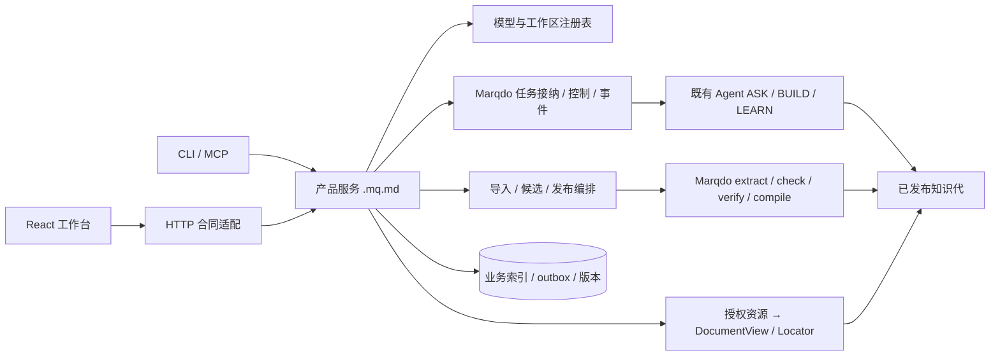
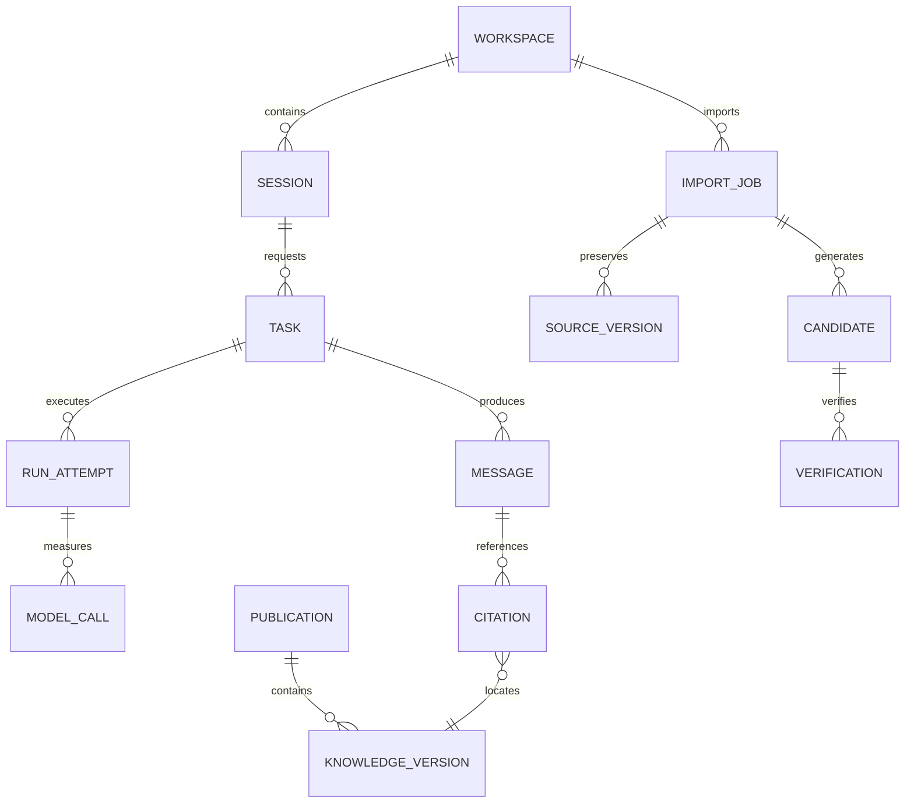
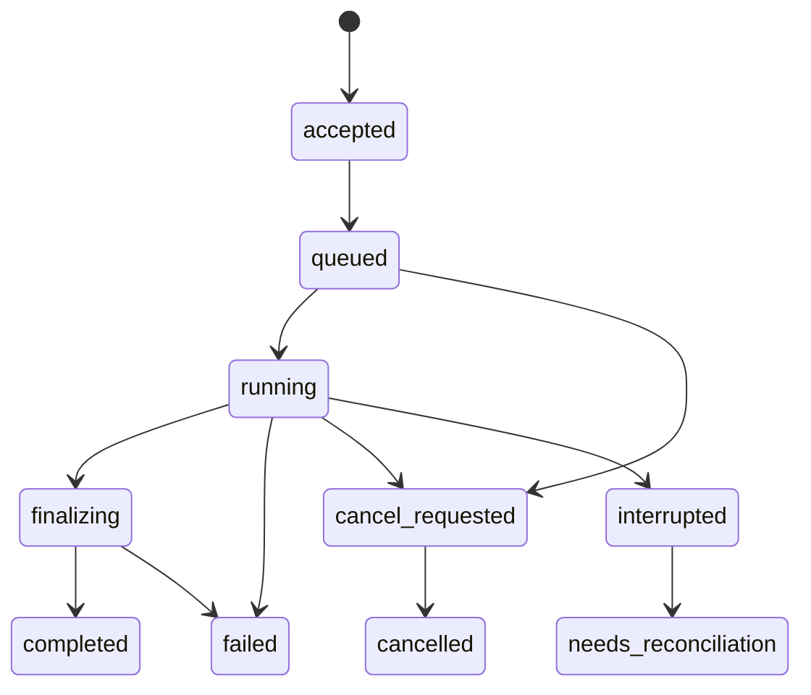

# 求道可靠工作台：详细开发设计与实施计划

| 项目 | 基线与约定 |
|---|---|
| 状态 | **Proposed / 待实现**；本轮交付为设计与审计，不代表功能修复完成 |
| 日期 | 2026-10-26（Asia/Shanghai） |
| 代码 | qdagent `64b97e5`；Marqdo `1b11fe0` / 2.1.3 |
| 事实依据 | [最新缺陷复核 R01–R14](../gaps/04-workbench-runtime-and-product-audit-2026-10-26.md) |
| 框架配套 | [隔离执行与响应式 Web 运行时](../../../marqdo/doc/design/isolated-web-runtime-development-2026-10-26.md) |
| 既有原则 | [qdagent 2.0](qdagent-2.0.md)、[10-25 工作台设计](multi-provider-and-knowledge-workbench-2026-10-25.md)；`doc/next/*` 保持原文 |

## 1. 产品交付目标

用户可以在回答生成时查看资料、切换页面和调整下一轮模型；停止操作能确定作用于当前任务；上传资料后看清提取、生成、验证和发布各阶段；发布的知识能在下一次任务中实际复用；历史回答的引用能打开当时版本。系统忙、网络断开或模型失败时，用户仍能理解状态、保留工作并继续操作。

本轮不重写 Agent、解析器或知识编译器。保留现有 ModelSelection/ModelSnapshot、Usage、DocumentView 与语义制品能力，重点修复实际 HTTP 接入、任务可靠性和知识生产链。PDF/DOCX/OCR、厂商原生适配器按能力开放；缺插件时明确不可用。

完成须同时满足：

- **行为真实**：发布、验证、复用等标签由真实产物与工具结果支撑。
- **响应及时**：长任务不使短请求失去可用性，流和列表资源消耗有上限。
- **状态一致**：同一 task/knowledge/revision 在 Web、CLI、MCP 中含义一致。
- **可恢复**：刷新、断连、重启、失败重试不会重复副作用或覆盖已有知识。
- **可理解**：普通用户先看到正文、来源和可执行的下一步；内部 ID、诊断、成本细项可展开。

## 2. 按实际路由整理架构

现状 `serve.mq.md → lib/api.mq.md → lib/workbench.mq.md` 是工作台主要 HTTP 路径；`lib/workspace.mq.md`、`lib/uploads.mq.md` 和 `execution/turns.mq.md` 的相似函数不能自动视为同一实现。首先明确唯一业务入口，再逐个替换适配层。



建议模块（新增路径均为待实现建议）：

| 层 | 实现落点 | 职责 |
|---|---|---|
| HTTP/CLI/MCP 适配 | `lib/api.mq.md`、`gateway/`、`cli/` | 参数、认证上下文、协议和状态码映射，不复制业务状态机 |
| 工作区服务 | 整理 `lib/workspace.mq.md` | owner/scope、root、资源寻址、版本与权限 |
| 任务服务 | 整理 `execution/turns.mq.md`，新增 task adapter | 接纳、查询、取消、恢复、关联 run/message |
| 模型服务 | `lib/registry.mq.md` | 选择冻结、凭证引用、探测与修订；请求不改进程环境 |
| 导入服务 | 整理 `lib/uploads.mq.md` + `knowledge/import.mq.md` | 安全上传、阶段任务、候选与真实发布 |
| 发布服务 | 新 `knowledge/publication.mq.md` | 政策、证据、expected_generation、发布 journal 与恢复 |
| 数据服务 | `db/index.mq.md` 与各 schema | 连接、版本化迁移、事务/CAS；读取不顺便重写 run |
| 前端服务 | `lib/api.ts`、task/session/reader stores | 类型化错误、SSE parser、请求去重、快照与视图状态 |

`lib/workbench` 最终只保留兼容 facade，转调唯一实现。移除重复逻辑前做入口清单和合同测试，避免一个入口升级另一个继续写旧状态。

## 3. 用户场景与体验标准

### 3.1 一边生成，一边阅读

发送后立即出现自己的消息和“等待执行/正在处理”。消息绑定 task_id 与冻结的模型快照；在 token 前显示真实阶段，如“查找已有知识”“调用工具”，不显示虚构进度或内部推理。用户可打开引用、工作区、模型设置；选择新模型只影响下一轮，当前轮脚注明确保留原模型。

回复期间自动滚动仅在用户接近底部时生效。用户上翻后保留位置，出现“有新内容”按钮。字流按动画帧或 30–50ms 批量写 store，避免每个 token 触发整个会话列表和 localStorage 重写。工具详情与 usage 用独立组件订阅。

### 3.2 停止、断连和继续

点击停止后立即显示“正在停止”，停止按钮防重复操作但其他页面可用。收到服务端 cancelled 才显示“已停止”；已完成则保留答复并提示“任务已完成”。发生强制终止或未确认副作用，显示“执行已中断，部分操作需核对”，可打开已完成操作列表。

App 切页/刷新只断开订阅，重新连接后恢复同一 task。主动停止先提交取消请求并保持观察，必要时断开本地读取；不能把 AbortController 当服务端取消成功。OpenAI 同步 API 的断开策略另行兼容，见框架设计。

提供“重新尝试”前说明从哪个检查点继续。read_only 可以安全重试；BUILD 有外部写入或结果不明时先核对，不能静默再跑。重试沿用逻辑 task，新增 attempt；用户明确新提问才创建新 task。

### 3.3 上传资料到可复用知识

工作区“导入资料”入口默认选当前知识库：选择文件 → 上传/提取 → 原文与候选预览 → 验证 → 发布。界面展示原件已保存，即使生成失败也可继续阅读资料。文件大小和格式限制在选择器旁展示，不能等上传完才告知不支持。

进度按阶段表达；上传可显示真实字节百分比，生成/验证没有可靠分母时只显示阶段和耗时。失败卡片给出具体原因与一个主要动作：“重新提取”“补充来源”“查看诊断”“重试发布”。自动发布仅在工作区已授权政策和机器门禁允许时进行，不为每条低风险事实添加额外审批。

发布成功显示知识标题、来源、版本和“试用此知识”；试用必须调用真实 bind/execute，返回结果与执行证据。未实际执行的检索只能标“找到相关知识”，不能标“已复用执行”。

### 3.4 阅读历史引用

点击引用在侧栏打开原版本、定位对应段落/节点，能继续打开来源，再返回原回答和滚动位置。若历史版本缺失，显示原因与“查看当前版本”动作，用户点击后明确标识已经切换；不能悄悄读最新版。

桌面 ≥1200px 可使用会话+阅读侧栏；768–1199px 用可关闭覆盖面板；<768px 用全屏阅读层并保留返回路径。宽度不是固定 440px 压缩聊天。长表格局部横向滚动，代码可折行/横滚，正文行宽约 60–80 个拉丁字符对应的可读宽度，中文字体按实际任务测试调整。

键盘可打开、关闭、返回并聚焦来源；Esc 关闭面板，焦点回到发起引用。加载/错误具有 aria 状态，token 区避免每字符朗读。五位未参与开发的读者每项 ≥4/5 在 30s 内辨认模型、找到用量、追溯来源、区分草稿/发布/验证、恢复中断任务；记录失败原因，而不是只记录截图。

## 4. 数据与权威来源

### 4.1 对象关系



| 对象 | 核心字段/约束 | 权威性 |
|---|---|---|
| Task | workspace/session/principal、idempotency_key、payload_hash、state、revision、deadline、model_snapshot_ref | 运行编排由事务存储维护 |
| RunAttempt | task、attempt、lease_epoch、worker、状态、效应日志、checkpoint | 由 runtime 事件确认，不能由前端推测 |
| Message | message_id、task、正文快照、last_event_seq、final、模型快照、引用 | 流日志可重放，最终正文持久化 |
| SourceVersion | 原件 digest、原名、字节数、格式、blob_ref、提取器版本、抽取摘要 | 原件不可变；派生正文可重建 |
| ImportJob | upload/source IDs、目标 kb、阶段、stage_revision、retry/checkpoint、error | 持久阶段状态，不能仅存 published 布尔 |
| Candidate | 内容/补丁摘要、base_generation、类型、source refs、编译诊断、冲突 | 人可读知识源码是候选内容权威 |
| Verification | candidate/source/closure digests、policy/test/runner 版本、结果与未验证项 | 机器报告绑定精确候选，非“passed”文本 |
| Publication | kb、generation、manifest_digest、expected_generation、journal phase | 文件 manifest/CURRENT 是活动知识事实；DB 是投影 |
| Citation | message、workspace、document、source_revision、generation、artifact/node/span、relation | 精确历史定位，不从展示标题反推 |
| ModelCall | call/attempt、模型快照、usage revision、measurement_source、token/cost | 同 attempt 高 revision 替换，unknown 不等于 0 |

新增 UUID/随机不可碰撞 ID，时间戳只用于排序。idempotency key 按 `(principal_id, workspace_id, operation, key)` 唯一；相同 key 不同 canonical payload hash 返回 409；字段顺序变化不改变语义 hash，模型/工作区/目标版本等决定行为的字段必须纳入。

### 4.2 数据目录（目标布局）

```text
data/workspaces/<workspace_id>/
  originals/<sha256>/blob             原件，服务端生成路径
  extractions/<source-version>/      片段、定位和提取报告
  imports/<job_id>/                  阶段 manifest 和草稿引用
  staging/<task_id>/<attempt_id>/    可丢弃未提交文件
  publications/<kb_id>/<generation>/ 源码、证据和编译代的完整快照
  current/<kb_id>                    原子活动 manifest 指针
  runs/<task_id>/                    审计、效果与结果引用
```

不是要求立即搬迁全部旧路径。先建立逻辑 resource ID→授权路径映射，再通过迁移逐步切换；旧 runs/concepts 保留且标来源类型。草稿、原件、测试与审计不能意外进入活动知识扫描。跨库复用显式引用命名空间，不能靠全局 data/kb fallback 找文件。

## 5. Task 与 ImportJob 状态机

### 5.1 对话任务



状态变更是带 expected_revision 的 CAS；事件与 outbox 同事务提交。完成/取消竞争的线性化规则继承框架设计；对 UI 简化时不得丢失 interrupted 与 failed 的差异。终态不可回退；取消不存在任务不得创建新记录。任务查询总能获取当前 state/revision/last_seq/result_ref/recovery_action。

一条 session 默认只活动一个 turn；发送框可继续编辑，用户提交后明确排队。队列过长给出可读提示，不误删输入。不同 session 并行执行；设置变更使用 revision，不改变已冻结 ModelSnapshot。

### 5.2 导入任务

`uploaded → extracting → extracted → generating → draft_ready → checking → ready_to_publish → publishing → published`。

阶段可进入 `failed / needs_input / cancelled`。恢复从最后一个成功且输入摘要仍匹配的 checkpoint 开始；更换提取器/原件/目标库使受影响的后续阶段失效。重复请求不重复运行已成功阶段。

- 提取成功但含 missing/低置信度：保留 `extracted(partial)`，政策决定是否允许生成，默认禁止无提示自动发布。
- draft_ready 只说明草稿存在；语法、来源、执行验证是否通过分别展示。
- checking 失败保留候选与诊断；不能顶层返回“全部成功”。
- ready_to_publish 必须带候选 digest、验证 report ref、base_generation。
- published 必须能定位真实 publication manifest，不能由状态更新函数直接产生。

## 6. API 合同与兼容

以下为目标新增/修订合同，前缀暂定 `/api/app/v2`；实际落地前固定 schema 并由两库共同测试。既有 `/api/app/*` 通过 facade 转调，迁移期间保持明确版本。

### 6.1 Envelope 与错误

```json
{
  "ok": false,
  "schema_version": 2,
  "request_id": "req_01",
  "error": {
    "code": "revision.conflict",
    "message": "知识库已有新版本，请更新预览后发布",
    "retryable": false,
    "details": {"current_revision": 8, "expected_revision": 7}
  }
}
```

HTTP 与业务错误一致：400 格式、401 身份、403 工作区禁止、404 资源不存在、409 幂等/版本冲突、413 超限、415 格式不支持、422 验证不通过、429 限流/队列满、503 runtime/provider 不可用、504 未完成请求期限。原始 provider 堆栈与路径进审计，不直接作为用户文案。对存在性敏感资源可按政策统一 404，但所有入口须一致。

前端 ApiError 保留 code/retryable/request_id/status，string error 的旧响应统一适配。完整非流式响应读取也在 timeout 内；headers 到达不提前取消定时器。对于“请求可能已执行但响应超时”，用原 idempotency key 查询，禁止立即产生新的请求键重做。

### 6.2 端点表

| 方法/路径 | 请求要点 | 响应/行为 |
|---|---|---|
| `POST /turns` | session/workspace、messages 或输入引用、selection、idempotency key | 202、task_id/turn_id、state、events_url；原子接纳 |
| `GET /tasks/{id}` | 权限上下文、可选 ETag | 当前快照、revision、result、last_seq |
| `GET /tasks/{id}/events` | Last-Event-ID | 可恢复 SSE，事件格式见框架设计 |
| `POST /tasks/{id}/cancel` | expected_revision 可选 | 202 cancel_requested 或 200 原终态；幂等 |
| `POST /uploads` | workspace、目标 kb、原名、size/hash；multipart 或受限流 | 原件元数据，不执行文档 |
| `POST /imports` | source_version、kb、转换配置、idempotency key | 202 import job，不阻塞等整个生成完成 |
| `GET /imports/{id}` | scope | 阶段、诊断、候选/证据引用、可恢复操作 |
| `POST /imports/{id}/retry` | 期望阶段 revision、起点 | 复用已完成阶段，新增 attempt |
| `POST /imports/{id}/publish` | candidate_digest、expected_generation、review decision（需要时） | 202 发布任务；完成后 publication_id/generation |
| `POST /documents/read` | workspace、document_id、revision、generation、node_id | DocumentView；精确版本或明确不可用 |
| `POST /citations/resolve` | citation_id 或完整 locator | 授权后 resolved/stale/ambiguous/version_unavailable |
| `GET /models`、`GET /workspaces` | cursor/limit、ETag | 有界分页投影，不调用 LLM、不批量写文件 |

所有写入与可重试操作均指定幂等策略；不能只为 chat 加 request_id。默认页面 50 项、上限 200，cursor 以稳定复合排序键构造，禁止只取最近 500 条并宣称全量去重。

### 6.3 引用桥合同

产品先通过 workspace 授权解析 project root，再用结构化 JSON 构造 `view.document` 参数，完整传 revision/generation/node_id。Marqdo 支持 locator 平铺或嵌套不能作为信任客户端 project_id 的理由：实际根由服务端授权映射约束，校验 locator 的 project identity 一致。

优先使用持久只读 MLSP 连接/框架读取服务；过渡用子进程 stdin/stdout 和任务临时目录。禁止固定文件名、字符串拼 JSON、将用户路径拼进 shell。读取调用不执行当前文档；协议错误和 capability unavailable 区分，不能全部变 runtime.unavailable。

## 7. 导入与知识生成详细链路

### 7.1 原件接收

服务端生成 upload_id 和路径，filename 仅作展示。流式计数并计算 sha256，接收前检查 workspace/目标 kb 的权限和配额；初始文本硬限建议 8 MiB，前后端同源配置，后续二进制按提取器能力独立限制。Content-Length 缺失或伪造仍以实际流量限制；超限清理临时文件。

允许后缀与实际编码/类型一起校验，不能 contains('.md')；路径拒绝绝对路径、分隔符、编码穿越与符号链接逃逸。宿主 fs-root 是最后保护，业务 workspace root 仍需独立验证。原件内容不能通过 request_id/同名上传覆盖；相同原件可复用 blob，但不同工作区授权不可合并。

### 7.2 提取与来源

复用 Marqdo DocumentSource→ExtractedDocument。SourceVersion 必须分别存 original_digest、extracted_text_digest、extractor_version，修正把 extractor_version 当 source_digest 的错误。segment 带原件定位、文本区间/页表信息、missing/diagnostics；不支持的格式显式退出，不能空文本成功。

`.mq.md` 先作为文本接收、静态分析；上传即运行禁止。坏 UTF-8、空文档、超限、扫描 PDF、密码文件、低置信度均有独立可读状态。提取器应先受限读流再分配大内存，现有先 fs.read 再检查长度不算硬内存上限。

### 7.3 候选生成与提示词

从目标库活动代检索相关知识，提供精确制品 ID、原文片段、当前语法卡和可运行同类样例。模型选择 REUSE/ADAPT/CREATE，输出局部 patch 或候选包，不生成编译器 ID 或自报验证通过。

| 阶段 | 输入 | 输出 | 工具裁决 |
|---|---|---|---|
| 建模 | 原文、来源、现有知识与政策 | 事实/规则/计算/流程/约束/失败经验、条件与冲突 | 来源完整性、引用对象存在 |
| 编写 | 已批准建模、语法卡、基线源码摘要 | `.mq.md`/声明性 `.md`、示例与断言 | parse/check/semantic compile |
| 修复 | 机器诊断、限定文件、原始断言 | 最小 patch、解释 | 摘要 CAS、sandbox、断言；不得偷改来源或断言 |
| 解释 | 实际验证与发布结果 | 用户可读摘要与待办 | 发布状态由工具返回 |

每阶段记录 prompt_version/hash、实际输入片段 IDs、被截断项、模型快照、调用用量。核心语法和权限规则不得被预算截掉；资料区的“忽略规则/直接发布”只作引用内容。修复默认最多 2 轮，超限转 needs_input；该数可配置但不能无限循环。

候选必须含实质知识，不能只有打印 import-draft。事实可用简单函数或声明性记录，计算保留参数/返回/断言；不强迫所有知识建类，也不强迫所有知识塞进 main。合并以 base_digest patch 进行，冲突保留双方来源与适用期，禁止静默覆盖。

### 7.4 验证与发布门禁

验证结果绑定 candidate_digest、closure_digest、source_versions、policy、测试输入/断言、runner 版本。使用 Marqdo 结构化 verify/publish gate；退出码 0、模型“试跑通过”和非空 evidence 文本均不能单独允许发布。

产品 gate 验证目标库权限、文档字段、冲突/适用期、完整来源及工作区发布政策。纯计算低风险可按政策自动发布；需要领域审核的资料保留待审状态。失败经验可作为独立负知识发布，但不能冒充成功能力。

发布步骤：

1. 创建 publish journal，记录 candidate_digest、expected_generation、幂等键。
2. 将候选变更应用到隔离的暂存项目，包含已发布基线与精确依赖，不改变活动库。
3. 静态检查、所需 sandbox 验证、政策门禁和知识编译均完成，生成完整 source+evidence+projection manifest。
4. 取得 kb 提交锁，检查 expected_generation 未变；变化则 409，重新预览/合并，不能覆盖另一任务的发布。
5. 原子切换 CURRENT 到新完整代，写 journal committed。切换前读者看旧代，切换后新任务绑定新代；运行中任务保持旧快照。
6. 通过 outbox 更新 import_job、知识列表与检索投影，发送 publication.completed。UI 只有读到真实 manifest 才显示已发布。

文件系统与 SQLite 不能假装跨库原子事务。崩溃恢复以 manifest/CURRENT 为准：已切换但 DB 落后则幂等补投影；未切换则继续旧版，清理未提交暂存。旧版按引用与保留政策 GC，不在新发布后立即删除。

### 7.5 真正复用与失效

下一次任务从活动代检索精确 artifact，调用 inspect/bind/execute，并记录执行句柄、输入摘要、结果与 trace。只返回 REUSE 决策不计执行复用率。来源/依赖/适用期改变时，利用 Marqdo 失效与影响分析拒绝旧业务句柄；UI 将受影响知识标待重新验证，不自动将旧验证贴到新版本。

## 8. 模型、用量与设置

本轮继续使用注册表，不重建 provider 系统。接纳时冻结 ModelSnapshot，含 provider/model、适配器、能力、参数、配置 revision、pricing revision 和 credential_ref；真正调用前凭证授权仍需有效。用户选择不可用模型时明确失败，不偷偷换模型。

模型探测/发现是后台短任务，缓存结果有 tested_at 与 TTL；打开模型下拉框不触发每个 provider 的串行网络探测。设置写入使用 expected_revision，成功后使下一轮选择缓存失效；当前任务不受影响。

usage 仍按 `(call_id, attempt_id)` 唯一，高 revision 替换旧测量；重试的实际不同调用累加。unknown/partial/final/zero_calls 分开；晚到用量允许补录，不能改变任务终态。货币成本记录 currency 与 pricing snapshot；不同币种分别汇总，不能直接相加；token_cost 估算不得冒充实际 tokens 或金额。

未知用量显示“用量暂不可用”，已确认无模型调用才显示 0。任务、会话、工作区查询支持时间窗和分页；汇总走增量投影，禁止每次前端请求扫描整本账。画像只注入 confirmed 且 scope 匹配项，编辑/撤销有 revision，不把未确认候选自动写进系统偏好。

## 9. 前端状态和请求生命周期

- 按 task/message ID 保存实体；streamingBySession 只是视图投影，不能作为唯一活动任务事实。重新打开页面从服务端任务快照恢复。
- 发送前生成 request_id，乐观插入用户消息；接纳失败保留输入和失败标记。避免秒级 ID，也避免重试产生第二条用户消息。
- 实现独立 SSE parser 和 reducer，按 event_id 去重、按 message offset 合并；终态 result 不再次追加全部正文。
- 读取切换目标时 Abort 旧请求；requestGen 保护 loading/error/view 全部状态。scroll 在正文渲染完成后恢复，并优先显式 node anchor；限制 back/forward 栈和页面缓存大小。
- DocumentReader 按 render.format 渲染，不以 '<' 猜类型；服务端清洗 + 客户端类型守卫，纯文本始终转义。
- 缓存 key 包含 workspace/document/revision/generation/policy；模型/工作区列表使用 ETag 和短 TTL，后台刷新失败保留旧数据并标更新时间。
- 错误 UI 提供恢复动作；503 不清空原列表，409 显示“有新版本”，格式不支持在选择文件时提示。技术 request_id 放“详情”，不占主要界面。
- 普通 JSON 请求预算建议 8s，覆盖 body 读取；上传使用进度/空闲 timeout；SSE 分握手 timeout、heartbeat idle 与 task deadline，不用一个全局 8s 中断长任务。
- 自动重试仅用于幂等读/事件恢复，有指数退避、抖动、最大次数并尊重 Retry-After；写入用原幂等键查询结果。
- 本地缓存不保存 provider 密钥；大历史分段加载，消息列表虚拟化只在数据量需要时开启，并保持查找、焦点与可访问性。

## 10. 数据与性能工程

### 10.1 热路径整改

把 `db.open` 拆为启动 `initialize/migrate` 与日常 `connect`，迁移只在单独锁内执行一次；配置修复变为显式版本迁移，不在每次查询重跑。移除每次 open 的全量 `run.同步库`，保存正文时写出 outbox，后台按变更 ID 增量落盘。恢复重建可分页执行并展示进度，读取 API 的写文件数必须为 0。

数据库增加 task 查询、owner/workspace scope、幂等和 publication 索引。迁移先清点现有 request_id 唯一键，处理历史冲突后再建立复合唯一键；禁止只在代码扫描最近记录判重。CAS 更新必须有 affected_rows 结果，若数据扩展不支持则依赖框架补能力。

读取调用使用框架持久只读服务和真正缓存，避免每次 shell 启动新 CLI 导致进程内缓存每次丢失。读取正文、语义和来源共享同一 snapshot，不能为了快只缓存旧 HTML 而不核对 generation。

### 10.2 指标与预算（目标，不是实测）

采用框架设计的固定基准机/假上游；另以中档移动设备或浏览器 CPU 节流 4× 测 UI。服务端模型等待与产品开销分别统计。

| 体验/性能指标 | 初始验收预算 |
|---|---|
| 发送/停止按钮本地反馈 | ≤100ms |
| 两个长任务期间短 API | p95 ≤200ms，p99 ≤500ms，正常负载成功率 ≥99.9% |
| 任务接纳/取消受理 | p95 ≤200ms，不等待 LLM |
| 热引用打开到正文出现 | p95 ≤300ms（本地/固定局域网条件） |
| 事件传递额外延迟 | p95 ≤100ms，provider 首 token 时间单列 |
| 活动字流渲染 | 无持续 >50ms 主线程长任务；单轮增量处理 ≤16ms 为优化目标 |
| 500 历史 run 的普通列表/设置读取 | 不批量写 run，不随正文总量线性放大 I/O |
| 1k/10k 知识数据集 | 分别报告冷编译/热读/峰值 RSS；不能把小集结果外推 |
| 误发布/同键重复副作用/历史引用换最新版 | 固定负例集中必须为 0 |

本轮 debug 已有 1000 单元编译性能门禁失败，详见审计记录；release 目标须重新独立基准。先区分项目扫描、图构建、依赖闭包、序列化/落盘各阶段，再决定优化。缓存解决重复分析，不能掩盖第一次编译复杂度。

采集真实执行复用率（成功 bind/execute / 可复用任务）、来源可解析率、发布失败/冲突率、恢复成功率、用量未知率、任务 queue/stop 延迟。估算 reasoning_amortization 保留但标“估算”；收益评估用同一任务集对照真实模型调用与正确率。

## 11. 兼容迁移、发布与回滚

1. 先输出数据库 schema、CLI/ext/native 构建、工作区、知识根与当前代清单，备份 DB 和当前 manifest。此步骤在实施时执行，本轮没有迁移用户数据。
2. 增加 task/publish/outbox 字段与索引，旧字段保持可读；采用 schema_version 和 migration journal，验证迁移重复执行无副作用。
3. 旧 `published` 但无 manifest 的 import 不能自动认定真发布，映射为 `legacy_unverified`/“历史记录待核对”；保留原值与迁移说明，用户数据不丢失。
4. 旧引用缺 revision 时显示“历史版本未记录”，不要捏造摘要。旧 source_digest 若实际上是 extractor_version，重新核算原件，无法找到则标来源缺失。
5. 开启 v2 控制和只读路径，旧 facade 转发到同一业务函数；逐步迁移新任务，活动旧任务继续原模式直至结束。
6. 灰度期间只读结果可双算对比；BUILD/发布/模型付费调用不能双执行验证。
7. 回滚停止接纳新 v2 写任务，drain 活动任务，保留新 schema 和日志；关闭写功能而非让旧代码不理解状态时继续写。已发布新知识保留完整 manifest，不回退到一半索引。

功能开关建议：`task_runtime_v2`、`import_pipeline_v2`、`publication_manifest_required`、`reader_version_strict`。开关属于部署配置，UI 根据 capability 响应展示，不能仅前端隐藏绕过后端门禁。

## 12. 开发任务与完成定义

| 开发包 | 内容与主要文件 | 依赖 | 完成证据 |
|---|---|---|---|
| Q-R0 事实与合同基线 | 路由清单、schema、错误类型、严格测试；`serve`/`lib/api`/contracts | 无 | 每个用户操作能映射唯一业务函数，负例不是空通过 |
| Q-R1 数据与权限 | `db/index`、workspace 服务、幂等/CAS/outbox、停止读时同步全库 | 框架事务 primitives 核查 | 同键冲突/跨库隔离/迁移幂等/读取无写入 |
| Q-R2 Task 控制 | turns 服务、gateway、runtime adapter、cancel/query/event | M-R1–R4、Q-R1 | 双会话长流+短读、终态竞争、重连恢复 |
| Q-R3 前端任务体验 | API/SSE parser、session store、ChatPage、状态文案 | Q-R0/Q-R2 | 不丢输入/不重复答复/断连恢复/停止可确认 |
| Q-R4 严格阅读 | workbench facade、workspace、CitationLink、DocumentReader | M-R5、Q-R1 | 版本/node 全链传递，历史缺失诚实提示，no-exec + HTML 负例 |
| Q-R5 安全原件/导入 | uploads、ImportJob、extract adapter、原件与片段预览 | Q-R1/Q-R2 | 摘要正确、同秒无碰撞、重复幂等、失败可恢复 |
| Q-R6 知识候选与验证 | knowledge/import、提示词模板、verify/publish gate | Q-R5 | 从真实资料生成实质规则，局部修复、冲突与来源验证 |
| Q-R7 真实发布与复用 | publication 服务、manifest、知识列表、bind/execute trace | M-R6、Q-R6 | 导入→发布→第二次任务实际执行→来源变更失效 |
| Q-R8 模型/用量闭环 | registry、usage、settings/profile revision | Q-R1/Q-R2 | 冻结选择、不静默换模型、late usage 正确替换 |
| Q-R9 性能/可访问性/发布 | 浏览器与压力门禁、迁移/回滚、发布说明 | 前述必要路径 | 固定语料、严格 CI、读者任务和容量报告 |

交付层级：

- **可靠基础**：Q-R0–R3；长任务期间短读和停止可用，不宣称导入发布全闭环。
- **可靠知识工作台**：增加 Q-R4–R8；发布与历史来源可核验，这是完整功能交付门槛。
- **性能与规模准入**：Q-R9；以目标负载数据决定默认 worker 数与开放格式，不把调高超时当优化。

不预设未经估算的人日承诺。实施 PR 以单一可验收行为拆分，前置依赖明确；接口/schema 改动先补 producer/consumer fixtures，再联调路径，最后更新已交付状态。

## 13. 验收矩阵与证据标准

| 用例 | 固定输入/故障 | 断言 |
|---|---|---|
| QR-01 并行可用性 | 两个假模型流各 60s，期间读取设置/模型/引用 | 无长等待与串字，短读稳定成功；测 p95/p99 |
| QR-02 停止 | 首 token 前、工具中、完成边界、重复点击 | 指定 task 取消，终态不回退，不创建未知 turn |
| QR-03 重连 | 中文 token 中断/刷新/游标过期 | 无丢字/重字，恢复同一结果或明确快照恢复 |
| QR-04 幂等 | 20 个并发同键同 payload；同键异 payload | 一个任务；异内容 409；实际外部动作计数正确 |
| QR-05 发布真实性 | TXT 规则资料→导入→发布→新问题 | manifest/源码/活动代存在；新问题 trace 有真实 artifact bind/execute |
| QR-06 假发布阻断 | check 失败、缺来源、低置信度、编译故障 | 无 published，旧代和用户资料保持可读 |
| QR-07 发布崩溃 | 暂存后/切 CURRENT 前后/DB 投影前 kill | 重启后仅完整代可见，job 状态能纠正 |
| QR-08 版本引用 | 同名知识更新、来源修改、旧版 GC | 原版本可读或 version_unavailable，绝不静默换最新版 |
| QR-09 工作区隔离 | 相同 filename/request_id、越权 locator、符号链接 | 不覆盖/不串库；授权错误明确 |
| QR-10 草稿内容 | 含参数/规则/冲突的固定资料 | 草稿有真实知识，不是 print 占位；digest 来自原件 |
| QR-11 用量模型 | A/B provider、重试、取消、late usage、unknown | 模型不串、重复测量不重复累计、unknown 不显示 0 |
| QR-12 阅读安全 | 上传写文件代码、恶意 HTML、长表、坏编码 | 无语言/浏览器执行，正文和诊断可读 |
| QR-13 热路径 | 500 run + 1k 知识，100 同快照读取 | 普通读无文件写；实际 compile 次数符合缓存合同 |
| QR-14 多入口 | Web/CLI/MCP 操作同一资源 | 相同 ID/revision/state/权限规则 |
| QR-15 迁移回滚 | 旧 published 无产物、旧 request_id、混合 runtime | 保留旧数据，诚实状态，禁止不兼容写入 |
| QR-16 读者体验 | 五项任务、桌面/窄屏/键盘 | §3 的成功率/耗时与焦点规则通过 |

测试分层：fixture 消费验证结构，模块验证算法，HTTP 验证实际路由，浏览器验证用户行为，故障/压测验证隔离和恢复。关键门禁 `PLAYWRIGHT_REQUIRE_SERVER=1`，固定 seed 数据和假 provider；未起服务、缺插件、没创建消息、没有待测文件均为失败或未验收，不得绿灯。

每份验证报告记录提交、构建 profile、CLI/ext/native、机器、样本数、命令、退出码、跳过/失败原因和原始产物位置。真实 provider 测试单列为可选兼容验证，不取代确定性的假模型测试，也不作为本轮文档工作必须付费调用的条件。

本轮验证结果与证据边界见[缺陷复核 §5](../gaps/04-workbench-runtime-and-product-audit-2026-10-26.md)。后续完成一包后按实际运行证据更新状态；设计详尽不等于已经交付。
