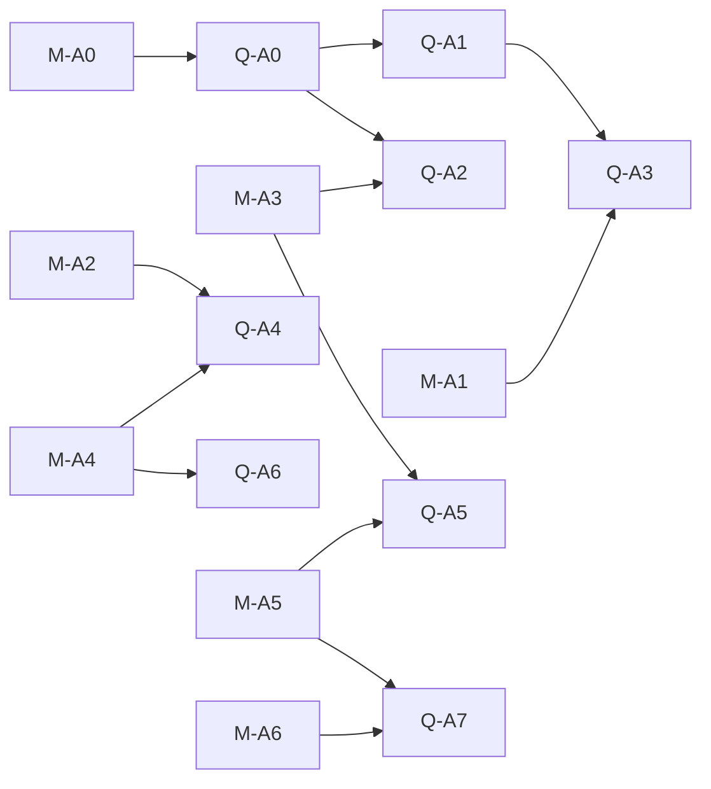

# 求道智能体能力开发计划（2026-10-27）

| 项目 | 约定 |
|---|---|
| 状态 | **Proposed / planning**；本文是产品侧排期镜像，**不是**已实现声明 |
| 日期 | 2026-10-27（Asia/Shanghai） |
| 基线 | qdagent `c4c976c`；Marqdo `6ffe5ce` / 2.1.4 |
| 产品设计真源 | [智能体能力与预览设计](../design/agent-capabilities-and-preview-2026-10-27.md) |
| 跨仓排期真源 | [Marqdo 跨仓 Agent 可靠性开发计划](../../../marqdo/doc/roadmap/agent-reliability-crossrepo-2026-10-27.md)（同级 checkout） |
| 框架协议真源 | [Marqdo 恢复、工具与资源协议](../../../marqdo/doc/design/agent-reliability-tools-resources-2026-10-27.md) |
| 证据 | [F01–F20 调研](../../../marqdo/doc/research/agent-capabilities-2026-10-27.md) |

**硬边界**：Marqdo 是唯一 Agent Runtime / EKC。本仓负责会话、鉴权、资源 ID 映射、UI、产品政策（回答长度、中文文案、供应商账户）与业务工具。**禁止**在 frontend / gateway / Python 另起 LLM 或 tool 循环。协议 schema 以 Marqdo 设计为准；本文不复制整份字段定义。

勿改 `doc/next/*`。

## 1. 与跨仓主线的关系

顺序原则（与跨仓主文档一致）：

1. **Q-A0** 与 **M-A0** 同步冻结 fixtures 与字段。
2. **Q-A1 / Q-A2** 立刻推进；侧栏预览**不**等待 CheckpointV2。
3. **Q-A3** 终态快照可先行；写恢复等待 Marqdo effect ledger。
4. 再 **Q-A4 / Q-A5 / Q-A6**；**Q-A7** 后置。

不能以建设大工具平台为由推迟侧栏预览和旧 raw 错误修复。

## 2. Q-A* 包明细

估算为熟悉两仓工程师的有效工作日区间，不是交付承诺。

| 包 | 优先级 / 建议耗时 | 代码落点与交付 | 框架依赖 / 退出门槛 |
|---|---|---|---|
| **Q-A0** 基线与合同 | P0，1–2 日 | 缺陷样例、资源/回答 fixtures、真实 HTTP 路由；设计与本路线图入口 | M-A0；mock/live 证据区分 |
| **Q-A1** 回答与错误一致性 | P0，2–4 日 | `agent/qdagent.mq.md` accepted candidate、失败 outcome；`gateway/openai`/api；摘要投影 | 可先复用 DocumentView；修复后只展示 B（F01–F03） |
| **Q-A2** 统一右栏与首批阅读 | P0，3–5 日 | `DesktopFrame`、panel store、`DocumentReader`；ResourcePanel/Preview；笔记/md/mq/txt/code | M-A3 可分批；点击不导航（F09–F14） |
| **Q-A3** 恢复闭环 | P0→P1，3–5 日 | `execution/turns`、session store、`api.ts`；终态快照、恢复动作、错误卡 | M-A1；事件恢复不执行工具（F08） |
| **Q-A4** 工具与上下文 | P1，4–7 日 | `agent/tools/`、工具目录、ContextAttachment；旧五工具适配 | M-A2/4；找→读→改→验证→预览 |
| **Q-A5** 格式与来源扩展 | P1，3–6 日 | JSON/CSV/图片/PDF、网页来源与页/行引用 | M-A3/5；PDF 不假称 OCR（F16） |
| **Q-A6** 计划与记忆管理 | P1，2–4 日 | 可折叠计划、预算 UI、profile 忘记、候选沉淀 | M-A4；压缩不丢约束（F19） |
| **Q-A7** 连接器/委派 | P2，另估 | MCP 配置与资源映射、程序化工具、可选浏览器 | M-A5/6；收益实测后开放 |

### 2.1 文件级落点

| 路径 | 工作内容 |
|---|---|
| `agent/qdagent.mq.md` | ResponsePolicy、候选提交、工具注册；调用现有 Marqdo run，不写新 loop |
| `execution/docgate.mq.md` | artifact 门禁与验证绑定；direct answer 适用范围 |
| `execution/turns.mq.md`、`db/turn_state.mq.md`、`db/turn_events.mq.md` | 快照 / recovery link / outcome；旧事件适配 |
| `lib/workbench.mq.md`、新 `lib/resources.mq.md` | 唯一资源服务；旧入口转调 |
| `serve.mq.md`、`lib/api.mq.md`、`gateway/` | 新接口与 CLI/MCP 共用业务函数；路由 fixture |
| `agent/tools/*.mq.md` | 笔记、文件、网页等业务工具声明 |
| `frontend/src/lib/api.ts` | 类型化 envelope、ResourceView、snapshot/recovery、AbortSignal |
| `frontend/src/stores/context-panel-store.ts` | 统一面板、back/forward、请求代数、分资源滚动 |
| `frontend/src/stores/session-store.ts` | answer channel、终态补齐、运行与连接状态分离 |
| `frontend/src/components/layout/DesktopFrame.tsx` | 删除双右栏状态，嵌入统一 panel |
| `frontend/src/components/reader/` | ResourcePreview 与按格式组件、outline/定位/安全 Markdown |
| `frontend/src/components/pages/NotesPage.tsx`、`WorkspacePage.tsx`、`ChatPage.tsx` | 同一预览服务、产物卡、简洁回答和恢复操作 |
| `frontend/src/contracts/`、浏览器 E2E、`tests/workbench/` | 针对真实缺陷的行为/HTTP/故障注入测试 |

## 3. 缺陷 → 包（产品侧）

| ID | 产品动作 | 包 |
|---|---|---|
| F01 | ASK 普通问答不强制六节；完整内容走产物通道 | Q-A1 + M-A4 |
| F02 / F03 | accepted candidate；outcome ≠ 输送 ok | Q-A1 |
| F04 / F17 | 业务工具目录；迁移 legacy 搜索 | Q-A4 |
| F08 | 终态快照补齐；恢复按钮映射 `recovery_options` | Q-A3 |
| F09–F14 | 统一右栏与安全渲染 | Q-A2 |
| F16 | PDF 预览诚实降级 | Q-A5 |
| F19 | ContextPack / 记忆边界 | Q-A6 |
| F20 | 资源解析与安全临时文件 | Q-A2 / Q-A4（配合 Marqdo ResourceRef） |

## 4. 验收（QA-01–QA-20）

完整矩阵见设计文档 §13。测试必须经过 `serve → api → 权威业务函数` 与真实前端点击；fixtures 不能替代浏览器实测。

重点零容忍门禁：

- 重复写效应、预览执行副作用、跨 workspace 越权 = **0**
- 页面刷新后终态消息补齐率 **100%**
- 100 次 A/B 乱序点击无覆盖

实现检查：`python3 scripts/check-contracts.py`、相关 workbench 测试、`npm test`、`npm run build`，再跑 Playwright。无服务时 E2E 明确 skip/失败原因。

Feature flags（与跨仓主文档一致）：`agent_output_v2`、`resource_panel_v2`、`agent_tools_v1`、`agent_recovery_v2`。灰度：单 workspace → 多 workspace → 真 provider/断网 → 默认开。关闭恢复时禁止旧路径盲重跑。

## 5. 伴生与不做

| 项 | 动作 |
|---|---|
| 可执行知识 S0–S6 | 不重开；消费 Marqdo 已门禁子集 |
| 知识支撑 F0（gaps/03 等） | 并行伴生，不阻塞 Q-A1/Q-A2 |
| 第二套 Agent Runtime | **禁止** |
| `doc/next/*` | **禁止修改** |

## 6. 下一步开工

与跨仓主文档「第一刀」对齐（另开实现回合）：

1. **Q-A0**（对齐 M-A0）合同与 fixtures  
2. **Q-A1**：raw→accepted、outcome 一致性  
3. **Q-A3 子集**：终态快照补齐  
4. **Q-A2**（对齐 M-A3 子集）：右栏真实预览（笔记 / md / mq / txt / code）

发布判据是 QA 场景与真实 HTTP/browser 证据，不是接口 200。
